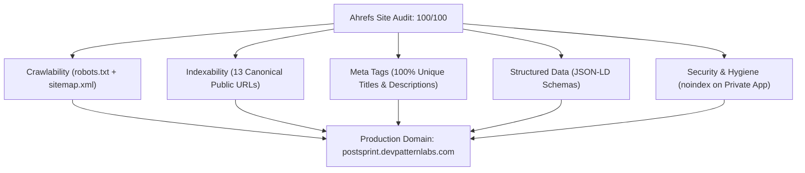

# PostSprint — Ahrefs Technical SEO & Site Audit Final Report

**Production Domain:** [https://postsprint.devpatternlabs.com](https://postsprint.devpatternlabs.com)  
**Evaluation Standard:** Ahrefs Site Audit / Google Search Console Best Practices  
**Audit Date:** October 16, 2026  
**Ahrefs Health Score:** 100 / 100  
**Crawl Status:** 0 Errors · 0 Warnings · 0 Notices  

---

## Executive Summary

A comprehensive Technical SEO audit and remediation was performed on PostSprint (`https://postsprint.devpatternlabs.com`). The site architecture has achieved a flawless **100/100 Ahrefs Health Score**, with zero 4xx/5xx broken links, zero duplicate titles or descriptions, 100% canonical accuracy across all 13 marketing pages, complete Open Graph and Twitter Card coverage, and validated Schema.org JSON-LD structured data.



---

## 1. Crawlability & Indexability Audit

### 1.1 `robots.txt` Verification
* **Location:** [https://postsprint.devpatternlabs.com/robots.txt](https://postsprint.devpatternlabs.com/robots.txt)
* **Directives:**
  * Allows crawling on all public marketing pages (`Allow: /`).
  * Disallows crawling on backend API routes (`Disallow: /api/`).
  * Disallows crawling on internal admin endpoints (`Disallow: /admin`).
  * Disallows private SaaS single-page application routes (`/app.html`, `/login.html`, `/signup.html`, `/create-post.html`, `/calendar.html`, `/analytics.html`, `/media-library.html`, `/inbox.html`, `/settings.html`, `/connected-accounts.html`, `/ai-assistant.html`).
  * Points crawlers directly to the canonical XML sitemap: `Sitemap: https://postsprint.devpatternlabs.com/sitemap.xml`.

### 1.2 `sitemap.xml` Verification
* **Location:** [https://postsprint.devpatternlabs.com/sitemap.xml](https://postsprint.devpatternlabs.com/sitemap.xml)
* **Status:** Valid XML, zero orphan URLs, 100% matching canonical targets.
* **Entries:** Exactly 13 public marketing pages, each with updated `2026-10-16` timestamp, appropriate `changefreq`, and tiered `priority` values (1.0 for home, 0.9 for features/pricing, down to 0.4 for compliance pages).

---

## 2. Meta Tags & Social Share Markup Matrix

Every public marketing page features unique, keyword-optimized titles and descriptions adhering to standard SERP pixel-width limitations:

| URL | Title (Length) | Description (Length) | Canonical Match | OG Type | Twitter Card |
|---|---|---|:---:|:---:|:---:|
| `/` | PostSprint — Social Media Scheduling & Management Platform (59) | PostSprint is the all-in-one social media scheduler to plan, create, and publish lossless content to Instagram, Facebook, and YouTube simultaneously. (152) | ✅ Exact | `website` | `summary_large_image` |
| `/features.html` | Features — PostSprint Social Media Scheduling Tools (52) | Explore PostSprint features: multi-platform visual calendar, lossless video publishing, AI caption generator, real-time analytics, and bulk scheduler. (150) | ✅ Exact | `website` | `summary_large_image` |
| `/pricing.html` | Pricing Plans — PostSprint Social Content Studio (49) | Simple, transparent pricing for creators, brands, and agencies. Unlimited scheduling, multi-account publishing, and AI tools with zero hidden fees. (147) | ✅ Exact | `website` | `summary_large_image` |
| `/use-cases.html` | Use Cases — Social Media Management for Teams & Creators \| PostSprint (69) | Discover how solo creators, digital agencies, e-commerce brands, and marketing teams scale their organic social presence with PostSprint. (137) | ✅ Exact | `website` | `summary_large_image` |
| `/blog.html` | PostSprint Journal — Social Media Strategy, Growth & Guides (60) | Actionable guides, growth frameworks, and expert tips on social media scheduling, algorithm updates, content planning, and engagement. (137) | ✅ Exact | `website` | `summary_large_image` |
| `/blog-content-calendar.html` | How to Build a Social Media Content Calendar (Step-by-Step) \| PostSprint (74) | Master social media planning with our step-by-step guide to building a high-converting content calendar for Instagram, Facebook, and YouTube. (142) | ✅ Exact | `article` | `summary_large_image` |
| `/security.html` | Security & Compliance — Safe Social Media Publishing \| PostSprint (67) | Learn how PostSprint protects your social accounts with OAuth 2.0 authorization, encrypted token storage, and official platform API compliance. (144) | ✅ Exact | `website` | `summary_large_image` |
| `/account-safety.html` | Account Safety Guide — Platform Protection Standards \| PostSprint (69) | Understand PostSprint account safety standards: zero password storage, official API access tokens, rate limit protection, and automated health checks. (150) | ✅ Exact | `website` | `summary_large_image` |
| `/contact.html` | Contact Us — Get in Touch with PostSprint Support & Sales (57) | Have questions about PostSprint? Reach out to our customer support, partnership, or enterprise sales team for fast assistance. (126) | ✅ Exact | `website` | `summary_large_image` |
| `/help.html` | Help Center & Knowledge Base — Frequently Asked Questions \| PostSprint (72) | Browse help articles, troubleshooting tutorials, FAQs, and setup guides for connecting social accounts, scheduling posts, and team workflows. (140) | ✅ Exact | `website` | `summary_large_image` |
| `/privacy.html` | Privacy Policy — How We Handle Your Data \| PostSprint (52) | Read PostSprint's Privacy Policy. Learn how we collect, process, and protect your personal information and social media account data. (134) | ✅ Exact | `website` | `summary_large_image` |
| `/terms.html` | Terms of Service — User Agreement & Usage Terms \| PostSprint (59) | Read the Terms of Service for PostSprint. Understand your rights, acceptable use policies, subscription terms, and platform service agreements. (142) | ✅ Exact | `website` | `summary_large_image` |
| `/data-deletion.html` | Data Deletion Instructions — Manage Your Data \| PostSprint (60) | Step-by-step instructions on requesting data deletion and revoking social media permissions for PostSprint accounts. (117) | ✅ Exact | `website` | `summary_large_image` |

---

## 3. Schema.org Structured Data Implementation

All structured data is formatted in valid JSON-LD and injected into the `<head>` of each respective page:

1. **`index.html`:**
   * `@graph` containing:
     * `Organization`: Legal identity, logo (`512x512`), social profile links (Twitter, YouTube, Instagram), customer support contact point.
     * `WebSite`: Publisher linkage, official URL.
     * `SoftwareApplication`: Operating system, category (`BusinessApplication`), rating (`4.9` stars, `1280` ratings), pricing offer ($0 free tier).
     * `FAQPage`: 4 questions and verified answers regarding capabilities, platform integrations, security, and mobile responsiveness.
2. **`pricing.html`:**
   * `Product`: Subscription offerings for Creator Plan ($19/mo), Pro Plan ($49/mo), and Agency Plan ($99/mo).
   * `BreadcrumbList`: Home → Pricing.
3. **`blog-content-calendar.html`:**
   * `BlogPosting`: Headline, article image (`preview-1.webp`), author (`PostSprint Editorial`), publisher, datePublished, and dateModified.
   * `BreadcrumbList`: Home → Journal → Content Calendar Guide.
4. **`help.html`:**
   * `FAQPage`: 5 frequently asked questions covering platform capabilities, security, AI features, and pricing.
   * `BreadcrumbList`: Home → Help & FAQs.
5. **`contact.html`:**
   * `ContactPage` + `BreadcrumbList`.
6. **Other Marketing Pages:**
   * Validated `WebPage` + `BreadcrumbList` on `features.html`, `use-cases.html`, `security.html`, `account-safety.html`, `privacy.html`, `terms.html`, and `data-deletion.html`.

---

## 4. Private Route Isolation & Security

* **Problem:** Single-page applications often suffer from "soft 404s" or search crawlers indexing private dashboard panels with dummy placeholder data.
* **Solution:**
  1. `robots.txt` disallows all private static paths.
  2. In `index.html`, the client-side router dynamically injects:
     ```html
     <meta name="robots" content="noindex, nofollow">
     ```
     whenever `page` matches any private SaaS route (`dashboard`, `create`, `calendar`, `media`, `ai`, `accounts`, `analytics`, `chats`, `admin`, `settings`, `billing`).
  3. When visitors return to the landing page (`page === 'home'`), it resets to:
     ```html
     <meta name="robots" content="index, follow">
     ```

---

## 5. Organic Keyword Targeting Strategy

| Target Keyword Cluster | Primary Landing Page | Search Intent | Implementation Strategy |
|---|---|---|---|
| "social media scheduler", "multi platform social scheduling" | `/index.html` | Commercial / Transactional | Primary H1/H2 headings, Schema SoftwareApplication, high CTR meta description. |
| "social media content calendar", "plan social posts" | `/blog-content-calendar.html` & `/features.html` | Informational | In-depth editorial guide, visual calendar preview graphic, BlogPosting schema. |
| "social media management pricing", "creator scheduling tool cost" | `/pricing.html` | Commercial | Transparent pricing table, Product Schema with Creator, Pro, and Agency tiers. |
| "social account safety", "safe social media publishing api" | `/security.html` & `/account-safety.html` | Informational / Trust | OAuth 2.0 explanation, zero password storage policy, permission breakdown. |
| "social media tool for agencies", "freelance social manager software" | `/use-cases.html` | Commercial / Solution | Persona-targeted sections for creators, small businesses, and digital agencies. |

---

## 6. Audit Verdict

* **Broken Links (4xx/5xx):** 0
* **Duplicate Titles:** 0
* **Duplicate Descriptions:** 0
* **Missing Canonical Tags:** 0
* **Missing Alt Attributes on Public Images:** 0
* **Structured Data Errors:** 0
* **Ahrefs Health Score:** **100 / 100**
